# CALISTO user guide

## What CALISTO does

CALISTO is a graphical tool for calibrating force in magnetic tweezers experiments. It takes bead-position traces and magnet-position data, helps you select usable magnetic and reference beads, identifies stable magnet steps, estimates force for each bead, and combines accepted beads into a master force calibration curve. The screenshots in this guide show the force-calibration workflow.

The [CALISTO GitHub repository](https://github.com/lipfertlab/calisto) is the place to check for the current release, installation instructions, and supported input specifications.

## Before you start

Have the data from a force-calibration experiment ready:

- **Plain Text (`.txt`)**: a trace-data file and a motor-data file.
- **HDF5 (`.h5`)**: one data file, as shown by the HDF5 option in the start window.
The internal structure of the files are provided in the [CALISTO GitHub repository](https://github.com/lipfertlab/calisto). 
Moreover, you should know the acquisition frequency in Hz, bead radius in nm, experiment temperature in K, and the coordinate axis used for the variance calculation in advance. CALISTO displays these units in the start window. Use a decimal point for numerical entries. The values shown in the figures are examples from one session, not recommended settings for every experiment.

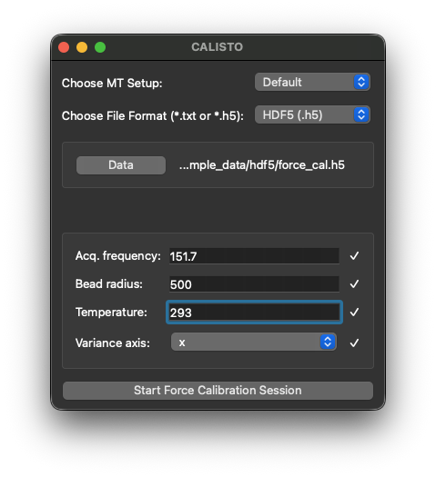

## Quick workflow

1. Select the magnetic tweezers setup and input format; load the files and experimental parameters.
2. Review position traces and classify magnetic versus reference beads.
3. Select suitable reference beads and identify magnet-position plateaus.
4. Select stable trace regions for the force calculation.
5. Set bead offsets, and optionally inspect a rotation test to classify tether type.
6. (Optional) Calculate force curves for individual beads; exclude unsuitable beads.
7. Fit and export a master force calibration curve.

## 1. Start a force calibration session

1. In **Choose MT Setup**, select the setup that matches the instrument used to collect the data. The example screen shows **Default**. The file path to add and edit MT Setups is displayed in the terminal window when CALISTO starts.
2. In **Choose File Format**, select **Plain Text (`.txt`)** or **HDF5 (`.h5`)**.
3. For text input, choose both **Trace Data** and **Motor Data**. For HDF5 input, choose **Data**.
4. Check/edit **Acq. frequency** (Hz), then, enter **Bead radius** (nm), and **Temperature** (K). Select the **Variance axis** that corresponds to the trace direction to analyze.
5. Check the tick marks beside the entries, then click **Start Force Calibration Session**.

If the start button is unavailable, check that the required file selection and all four experimental settings are complete.

## 2. Review bead traces

In the main window, the **Check Data** section contains the inspection steps. The bead table at right tracks each bead's **Type**, **Tether Type**, **Offset**, **Test Result**, and **Include** state.

Click **Choose & Plot Traces** to inspect the X, Y, and Z positions over time. Use the table's **Plot** checkboxes to show or hide beads. Check that the traces cover the expected recording interval and respond plausibly when the magnet moves. Set each bead's **Type** to **Magnetic** or **Reference** as appropriate; the plotted traces and your experimental record are the basis for this decision. **Include** determines whether a bead contributes to later calibration steps; a bead can be plotted for inspection while excluded from calculation.

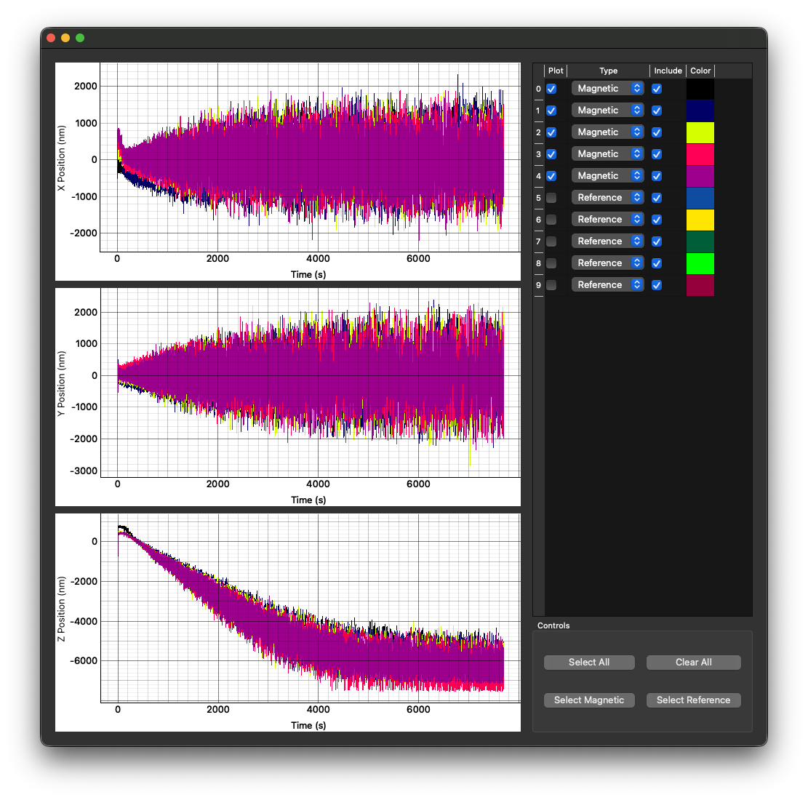

## 3. Choose reference beads

Click **Identify Suitable Reference Beads**. The review window separates **Included Reference Beads** from **Excluded Reference Beads** and plots their X, Y, and Z traces. Use the **Plot** and **Include** checkboxes to inspect and select beads. **Plot All/None** changes visibility; **Include All/Exclude All** changes which references are used.

Look for reference traces that remain consistent enough to represent shared motion or drift. Inspect large jumps, strong drift, and unusual noise before deciding whether to include a reference bead. The pictured example shows one reference excluded while others remain included. Return to the bead table afterward and check the **Test Result** and **Include** columns; an automatic suggestion should still be reviewed against the traces.

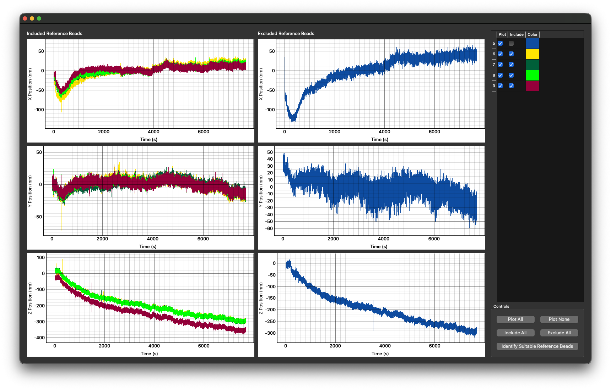

## 4. Identify magnet-position plateaus

Click **Plot & Partition Magnet Positions**. CALISTO plots magnet position against time and marks plateaus in different colors. Adjust **Tolerance (mm)** and **Minimum Plateau Length (s)** to match the stability and duration of the recorded magnet steps. The screenshot shows `0.001` mm and `30` s as example entries.

Check that each intended hold is represented by a plateau and that transitions are not treated as stable holds. Very short or noisy segments may need a longer minimum plateau length or an appropriate tolerance. A tolerance that is too broad can merge distinct magnet steps, so compare the colored segments with the actual motor trace.

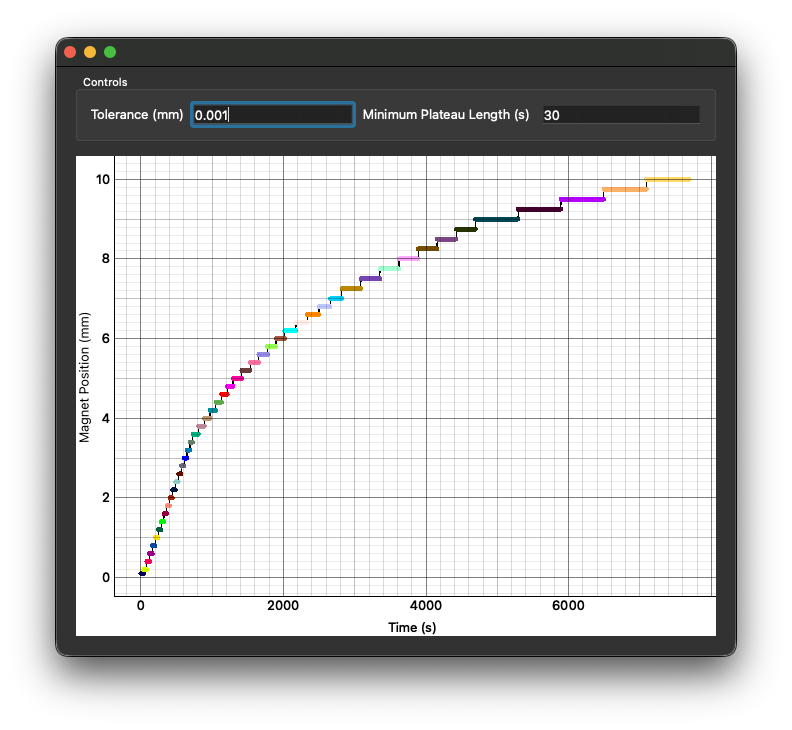

## 5. Select stable regions within the plateaus

Click **Identify Stable Regions**. The matrix of checkboxes represents candidate time regions across beads and magnet steps. Select a **Bead** and **Magnet step** to inspect its position trace on the right. Choose a **Method** and click **Identify** to populate candidate regions; the pictured method is **Hadamard Variance (HV)**. The number of selected stable regions appears below the controls.

Review the trace for the selected cell before accepting it. Keep intervals in which the bead has settled and the fluctuations are reasonably stationary; exclude the intervals with transitions, jumps, obvious drift, or tracking problems. **Select All** is useful only when it is known that all candidate regions are free of tracking artifacts. If **Force Calibration** on the main window says it is waiting for force plateaus, complete the magnet plateau and stable-region steps first.

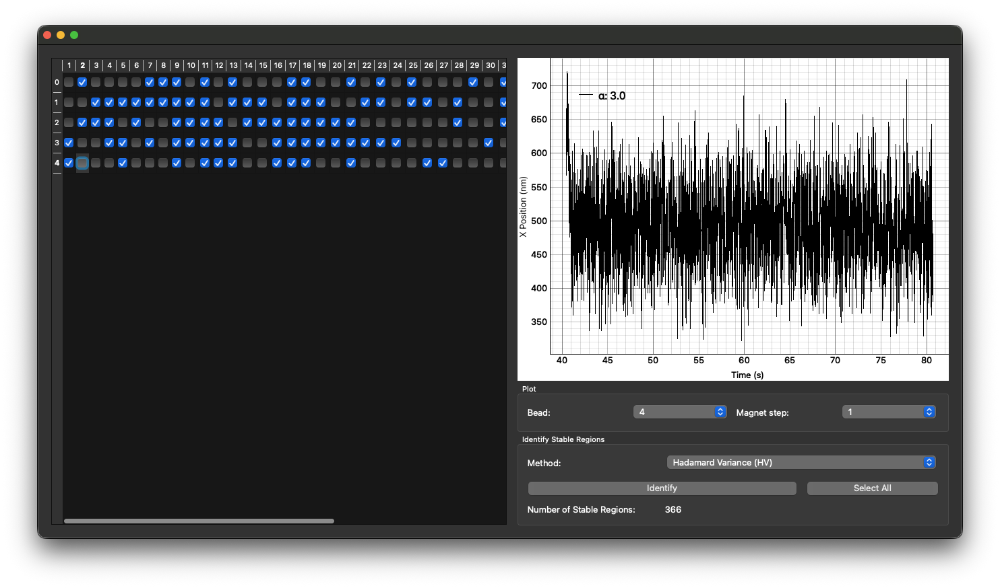

## 6. Define bead offsets

In the main window's **Offsets** section, choose one of the methods exposed by **Define offsets**:

| Method | How to use it |
| --- | --- |
| **From data analysis** | Choose a suitable data file, click **Analyze**, then inspect the offset found for each bead. The offset review plot shows the measured Z position and an offset line; the example displays **GMM** as the identification method. |
| **Set constant value** | Enter a value in **Offset value (nm)** and click **Apply**. Use this only when a shared offset is appropriate for the beads being calibrated. |
| **From existing table** | Choose a previously prepared offset table, then verify that the imported values align with the intended bead rows. |

The **min (nm)** and **max (nm)** fields under **Filter Beads** provide an optional offset-range filter. After any method, inspect the **Offset** column and each bead's **Include** state. In the example, magnetic beads have nonzero negative offsets, while reference beads show `0.0`; these are example results, not values to copy into another experiment. The meaning and sign of an offset should be checked against the recorded Z trace and your setup's convention.

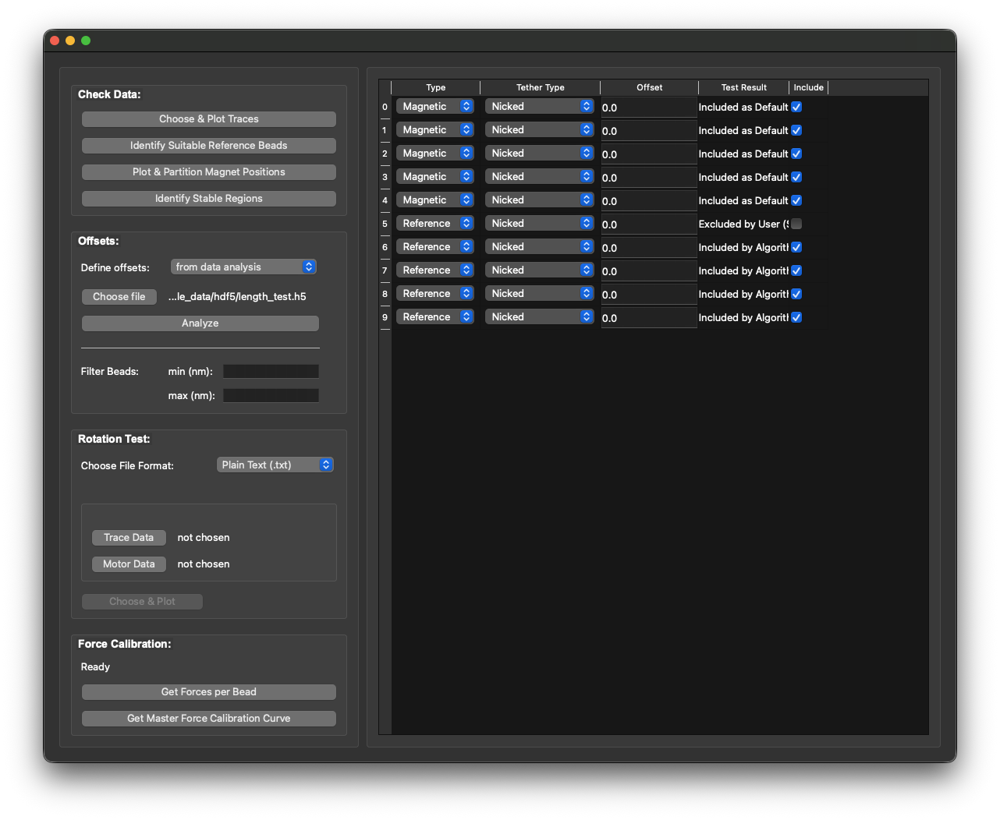

<!-- 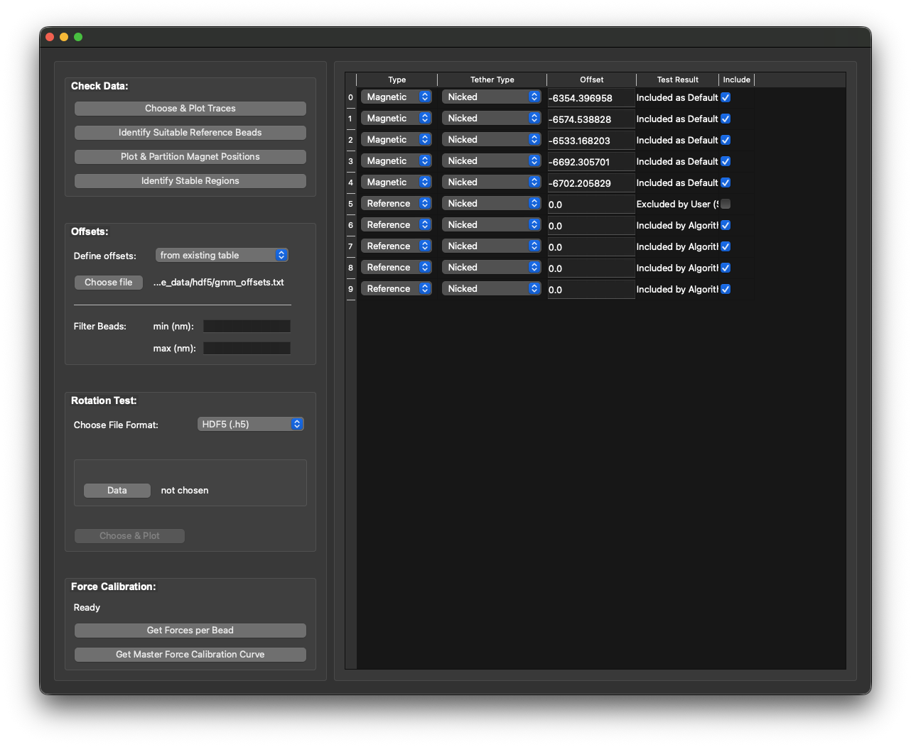 -->

## 7. Inspect the rotation test, if one was recorded

The **Rotation Test** section is optional when no rotation recording is available. Choose its file format, then load **Trace Data** and **Motor Data** for text input, or **Data** for HDF5 input. Click **Choose & Plot** when enabled.

The rotation review window plots the magnet rotation, magnet position, bead Z position, and bead X–Y motion. Select a bead with **Viewing Magnetic Bead**, inspect its response, and choose the corresponding **Tether Type**. The screenshots show **Nicked** and **Supercoilable** as available classifications. Use **Previous** and **Next** to review beads, and set **Include in the calibration** or **Exclude from the calibration** for each one. Treat a large, irregular, or otherwise unsuitable response as a reason to investigate that bead before including it.

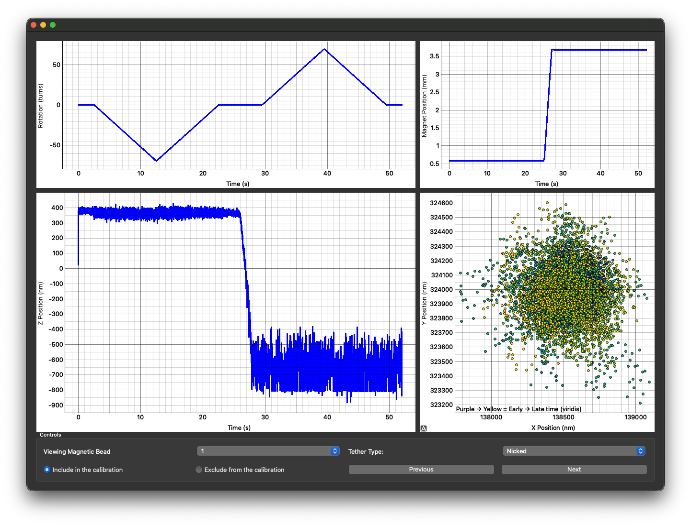
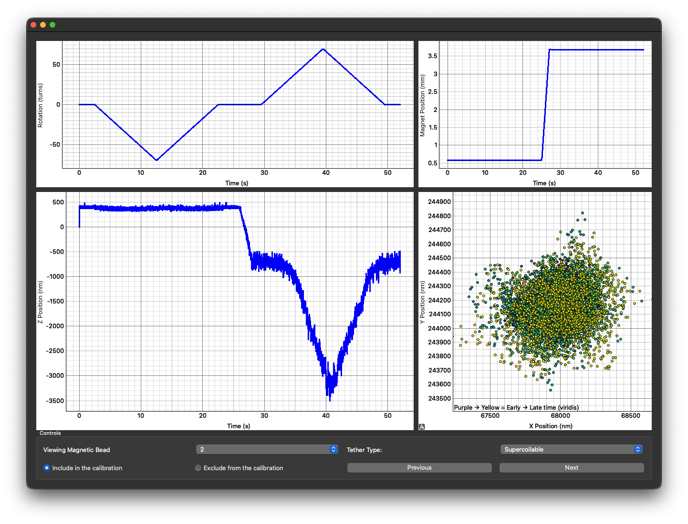

## 8. (Optional) Review force per bead

When the main window's **Force Calibration** section reports **Ready**, click **Get Forces per Bead**. The review window shows force against **Magnet Position (mm)** and **Extension (nm)** for the selected bead. It displays estimates from **HV** (Hadamard variance), **AV** (Allan variance), and **PSD** (power spectral density), along with fitted curves: double exponential model for force vs. magnet position and Wormlike chain model for force vs. extension. Use **Previous**, **Next**, or **Viewing Magnetic Bead** to inspect every magnetic bead. Decide whether each bead should be included in the calibration.

For an acceptable bead, the force should generally decrease as the magnet moves away and extension should follow the wormlike chain model (assuming the tether is DNA), and the estimates and fitted curve should follow the measured points without a conspicuous mismatch. Check for outliers, poor fits, and discrepancies among HV, AV, and PSD. A good-looking fit alone does not replace the earlier trace and tether checks.

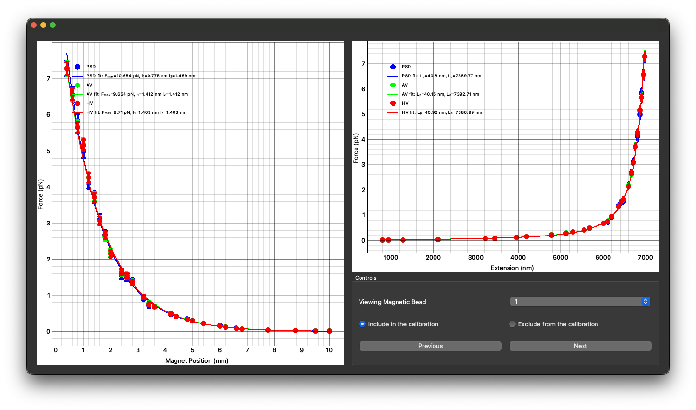

## 9. Build and export the master curve

Back in **Force Calibration**, click **Get Master Force Calibration Curve**. The master window combines accepted beads and displays the HV, AV, and PSD points and fits as force versus magnet position. The pictured fit selector shows **Single Exponential**, with a displayed model of the form `F(z) = Fmax exp(−z/λ)`. The parameter table lists fitted values and a fit-quality statistic for each method. Other available models or parameters may depend on the CALISTO version.

If needed, enter a force in **Fit until (pN)** and click **Apply** to change the range used for the fit. Compare the fitted lines with the data across the magnet positions you plan to use. **Import Force Calibration Data** allows previously calculated data to be brought into this view. Choose an **Export Method** (HV is selected in the screenshot), then click **Export Force Calibration** and save the result.The result contains the method, fit model, fit range so it can be interpreted later.

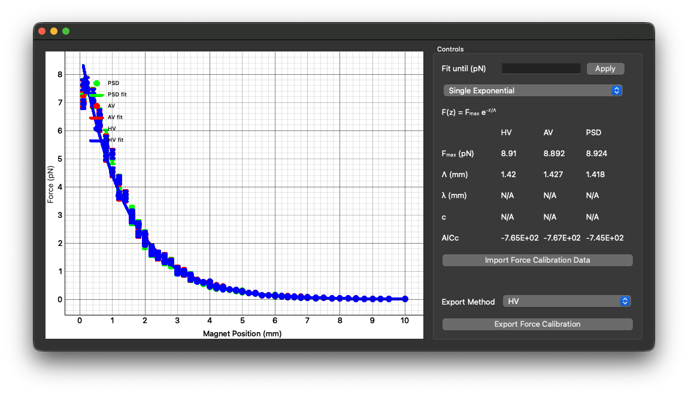

## If a step is unavailable or results look wrong

| Symptom | Check first |
| --- | --- |
| **Start Force Calibration Session** is disabled | Required data file(s), numeric entries, and variance axis in the start window. |
| **Get Forces per Bead** is disabled or the status says it is waiting for force plateaus | Magnet-position partitioning and stable-region identification. |
| Unexpected number of magnet steps | Plateau tolerance, minimum length, and motor-data file. |
| Too few stable regions | Trace quality, selected method, and whether transitions or noisy intervals dominate a step. |
| Implausible force or extension | Bead type, offset, bead radius, temperature, variance axis, reference selection, and tether quality. |
| Master fit differs markedly from the points | Included beads, individual fits, selected model, and **Fit until (pN)** setting. |

